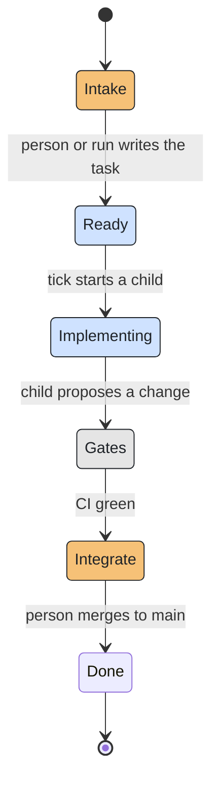

# Agentic Workflow — cozsolidarias

> Generated by `/flow-setup` from `.claude/flow.md` on 2026-11-16. Do not edit: change the parameters or the rules they point to, then run `/flow-setup audit`.

Work lives in the Flow project `proj_n70nb8jc3y`, under the standing decision [`task_5by41ffdhe`](https://flow.ttoss.dev/app/tasks/task_5by41ffdhe); GitHub holds the code and its changes, in `TriangulosTecnologia/cozsolidarias`. It runs the ttoss [Agentic Workflow](https://ttoss.dev/docs/engineering/workflow): every run reads a task's state from Flow, acts and writes it back, so the next run starts from the graph. The tick takes what ages fastest first ([process](https://ttoss.dev/docs/engineering/workflow/process#three-rules), rule 3).

Blue: a routine's run acts next. Orange: a person. Grey: automation.

| Stage     | Routine                                                     | Person                                      | Automation                                             | Governed by                   |
| --------- | ----------------------------------------------------------- | ------------------------------------------- | ------------------------------------------------------ | ----------------------------- |
| Intake    | what runs write as they notice it (`incubated` or `active`) | writes a task by hand                       | —                                                      | `Intake`                      |
| Decide    | —                                                           | choices reserved by the `Decisions` default | —                                                      | `Decisions`, `Ready brief`    |
| Implement | the tick starts a child per ready task                      | works a task in their own session           | —                                                      | `Before proposing`            |
| Gates     | —                                                           | integrates after reading the change         | `pr` workflow (typecheck, lint, test)                  | `Review` (none), `Merge rule` |
| Integrate | —                                                           | merges to `main`                            | —                                                      | `Merge rule`                  |
| Release   | —                                                           | —                                           | none: integrated is in effect once the pipeline passes | `Release procedure`           |
| Verify    | the tick's check child                                      | —                                           | —                                                      | `Closing evidence`            |

## Routines

| Routine | What it does                                                                                 | Runs                             | Here                                   |
| ------- | -------------------------------------------------------------------------------------------- | -------------------------------- | -------------------------------------- |
| Tick    | moves tasks through the stages: delegates, integrates, releases, verifies                    | `/flow proj_n70nb8jc3y`          | not scheduled: someone runs it by hand |
| Chase   | tells each person what waits on them                                                         | `/flow proj_n70nb8jc3y --chase`  | not set up                             |
| Health  | reports how the work flows, and proposes a standing rule from an answer given more than once | `/flow proj_n70nb8jc3y --health` | not set up                             |
| Audit   | finds where the agents spend tokens, files each fix as a task                                | `/token-audit --routine`         | not set up                             |

## Where each piece lives

| What                                  | Where                                                                                                                |
| ------------------------------------- | -------------------------------------------------------------------------------------------------------------------- |
| The method                            | [Get Things Flowing](https://flow.ttoss.dev/docs/agents/protocol.md)                                                 |
| The workflow                          | [Agentic Workflow](https://ttoss.dev/docs/engineering/workflow)                                                      |
| The skills                            | `flow`, `flow-setup`, `flow-friction`, `flow-me`, `token-audit`, `instruction-hygiene`, pinned in `skills-lock.json` |
| The parameters                        | `.claude/flow.md`                                                                                                    |
| The entry section every session loads | `CLAUDE.md` § Flow                                                                                                   |
| The runtime preset                    | `.claude/skills/flow/references/runtime-claude-code-remote.md`                                                       |
| Before proposing, quality gates       | `CLAUDE.md` § Quality Gates                                                                                          |
| The gates CI runs                     | `.github/workflows/pr.yml`                                                                                           |
