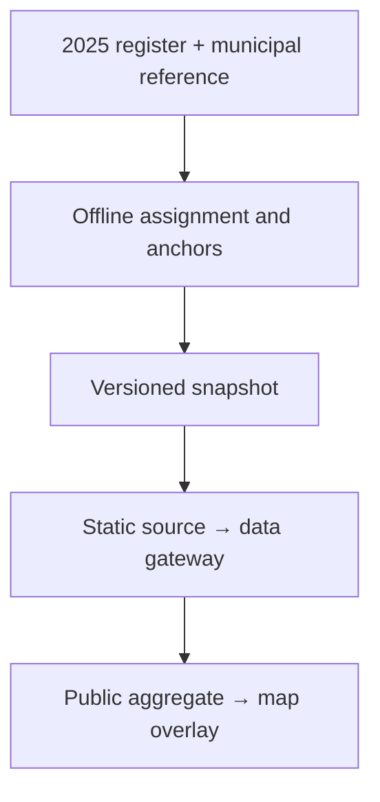

# Enabled kitchen share overlay (2025)

The independent `Camadas` toggle shows **habilitadas in municipality / all national kitchens in the treated 2025 register**, as a percentage. It is not a municipal habilitation rate or a population/area density. All administrative statuses contribute to the denominator; only exact `Habilitada` records contribute to the numerator.

## Data and provenance

The source contains 5,913 unique kitchen codes and 1,013 habilitadas. The generated snapshot assigns all habilitadas to 264 municipalities, including 256 without coordinates. Its national sum is 17.1317436%, not 100%. The input already excludes records removed during the earlier geocoding/operating-status treatment; this is not the denominator of the original unfiltered register.

Generate reproducibly with Node 24:

```bash
node --disable-warning=MODULE_TYPELESS_PACKAGE_JSON scripts/generateKitchenEnabledShare2025.mjs
```

The snapshot retains input SHA-256 hashes and assignment methods. Names resolve exactly within their UF after accent/case/whitespace normalization. `Embu das Artes/SP` is explicitly associated with `3515004`, the map reference's historical `Embu` entry. Unmatched names use point-in-polygon; unresolved habilitadas stop generation. The generated interior anchors account for holes and multipart polygons and are verified against the same geometry in tests.

The canonical public endpoint `/api/cozinhas/habilitadas-participacao` strips assignment IDs and provenance paths. It is fixed to 2025. Its denominator never comes from the subset of kitchens with map coordinates.



## Rendering and controls

The dataset loads on first activation and is reused across toggles. HTTP/network failures show a retry action. Loading does not fabricate zeros. A runtime observer in the map slot bridges the built-in control's visibility to the parent state, because geovis-workspace 0.15.2 has no layer-toggle callback.

Area is proportional to the percentage: `r = 38 * sqrt(enabledCount / maxCount)`. The installed adapter requires strictly positive radius bounds. The local scale therefore starts at one kitchen's exact proportional radius rather than a cosmetic minimum; the data contain positive municipal numerators only. `maxCount` is floored at two for degenerate one-kitchen fixtures. There is no Jenks classification or adaptive view-dependent rescaling.

The size legend uses the same radius function and stays separate from the thematic legend. The overlay sits below individual kitchen points. While active, competing kitchen-count/people circle layers and the people size legend are hidden, and the spec-wide `scaleMaxValue` is removed because it overrides local size scales. Turning off restores the original mode's symbols. Choropleth and CAF encodings remain available beneath the overlay.

Point and detail year is pinned to 2025 and timeline playback is disabled while the overlay is active. The user's previous timeline selection is retained and restored on deactivation. Other thematic datasets keep their own source dates. The new layer is not registered for AI map generation.

## Verification

Tests reconcile source records and assignments, validate every interior anchor, assert numerator/denominator separation, prove radius and area ratios, validate specs with the installed geovis package, and exercise lazy loading, retry, cancellation, year restoration and legend visibility. Existing catalog tests increase their expected dataset count from 13 to 14; coverage thresholds are unchanged.

The public API addition is classified high-risk by `devanity.rules.json`. The PR records the decision to serve an aggregate-only endpoint through the existing gateway, without credentials, dependencies or source-specific route logic.
