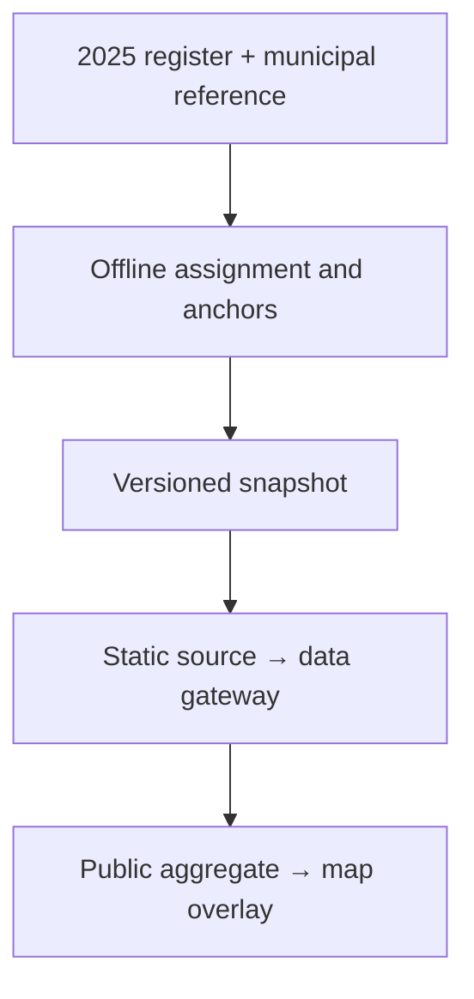

# Enabled kitchen share overlay (2025)

The independent `Camadas` toggle shows **habilitadas in municipality / all national kitchens in the treated 2025 register**, as a percentage. It is not a municipal habilitation rate or a population/area density. All administrative statuses contribute to the denominator; only exact `Habilitada` records contribute to the numerator.

## Data and provenance

The source contains 5,913 unique kitchen codes and 1,013 habilitadas. The generated snapshot assigns all habilitadas to 264 municipalities, including 256 without coordinates. Its national sum is 17.1317436%, not 100%. The input already excludes records removed during the earlier geocoding/operating-status treatment; this is not the denominator of the original unfiltered register.

Generate reproducibly with Node 24:

```bash
node --disable-warning=MODULE_TYPELESS_PACKAGE_JSON scripts/generateKitchenEnabledShare2025.mjs
```

The snapshot retains input SHA-256 hashes and assignment methods. Names resolve exactly within their UF after accent/case/whitespace normalization. `Embu das Artes/SP` is explicitly associated with `3515004`, the map reference's historical `Embu` entry. Unmatched names use point-in-polygon; any unresolved kitchen stops generation. The generated interior anchors account for holes and multipart polygons and are verified against the same geometry in tests.

The canonical public endpoint `/api/cozinhas/habilitadas-participacao` strips assignment IDs and provenance paths. It is fixed to 2025. Its denominator never comes from the subset of kitchens with map coordinates.



## Rendering and controls

The dataset loads on first activation and is reused across toggles. HTTP/network failures show a retry action. Loading does not fabricate zeros. A runtime observer in the map slot bridges the built-in control's visibility to the parent state, because geovis-workspace 0.15.2 has no layer-toggle callback.

Area is proportional to the percentage: `r = 38 * sqrt(enabledCount / maxCount)`. The installed adapter requires strictly positive radius bounds. The local scale therefore starts at one kitchen's exact proportional radius rather than a cosmetic minimum; the data contain positive municipal numerators only. `maxCount` is floored at two for degenerate one-kitchen fixtures. There is no Jenks classification or adaptive view-dependent rescaling.

The size legend uses the same radius function and stays separate from the thematic legend. The overlay sits below individual kitchen points. While active, competing kitchen-count/people circle layers and the people size legend are hidden, and the spec-wide `scaleMaxValue` is removed because it overrides local size scales. Turning off restores the original mode's symbols. Choropleth and CAF encodings remain available beneath the overlay.

Point and detail year is pinned to 2025 and timeline playback is disabled while the overlay is active. The user's previous timeline selection is retained and restored on deactivation. Other thematic datasets keep their own source dates. The new layer is not registered for AI map generation.

## Verification

Tests reconcile source records and assignments, validate every interior anchor, assert numerator/denominator separation, prove radius and area ratios, validate specs with the installed geovis package, and exercise lazy loading, retry, cancellation, year restoration and legend visibility. Existing catalog tests increase their expected dataset count from 13 to 14; coverage thresholds are unchanged.

The public API addition is classified high-risk by `devanity.rules.json`. The PR records the decision to serve an aggregate-only endpoint through the existing gateway, without credentials, dependencies or source-specific route logic.

## Municipal habilitation and food-insecurity exploration

`Camadas → Habilitação municipal (Tm) — 2025` adds a second, independent interpretation of the same snapshot:

- Circle **area** represents all registered kitchens in that municipality, with a fixed national maximum across scenarios and zoom levels. The blue sector represents `enabledCount / registeredCount`; grey represents all other administrative statuses. Circles below five registrations have dashed outlines. Zoom in to separate overlapping symbols.
- The source resolves **all 5,913 records to 904 municipalities**, with 1,013 habilitadas in 264 municipalities and **640 municipalities with registered kitchens but zero habilitadas**. There are no unresolved records. `municipalCoverage` carries both counts, the unrounded municipal percentage, and an interior anchor. All registered assignment methods remain in the offline snapshot, not in the API response.
- In the variations menu, choose CADINSAN with PBF, without PBF, or IVS, then activate the municipal layer. The CADINSAN scenarios use the same pooled national quintiles. IVS remains the project's **2010** snapshot. Other base maps remain available; the synthesis always uses CADINSAN (with PBF unless the selected variation is without PBF).
- The layer's **Síntese bivariada** button replaces the thematic fill with a 3×3 classification: pooled CADINSAN thirds × fixed municipal habilitation thirds (`<1/3`, `1/3–<2/3`, `≥2/3`). These are descriptive, relative bands, not clinical/EBIA severity. White means no kitchen in this register, grey means kitchens without a valid CADINSAN value, and dark grey means neither dataset supplies a value. Hover reveals counts and small denominators. The neutral municipality outlines and state boundaries remain above the fill.
- The evidence table pools `sum(enabled) / sum(registered)` within each **shared quintile**, separately for the selected CADINSAN scenario. It excludes missing risk values and displays actual denominators; it never averages municipality percentages. It uses the complete snapshot and does not claim a population- or UF-adjusted association.

The municipal control owns one stable transparent hit-test circle layer. The synthesis fill is not a member of its control group: geovis remembers group visibility and otherwise overrides a view-specific `visible` flag. Native SVG markers follow the camera, allow pointer events through to the spec tooltip, and are removed on synthesis, deactivation or unmount. Competing point/national circle controls are temporarily removed while municipal coverage is active, preserving their remembered choices for restoration. The snapshot is shared by both overlays, with one request per mount. Timeline and detail year stay fixed to 2025 whenever either overlay is active.

### Shared CADINSAN quintiles

Both `coropletico-cadinsan-com-pbf` and `coropletico-cadinsan-sem-pbf` calculate their four cutpoints **once from the pooled municipal percentages of both scenarios**, with each finite, nonnegative observation weighted equally. Quantiles interpolate at `(n−1)p` for `p = 0.2, 0.4, 0.6, 0.8`. Both maps, their legends and tooltip swatches use these identical cutpoints; viewport/UF/zoom does not recompute them. Valid zero is colored, while an absent denominator stays missing. Coincident cutpoints are consolidated rather than assigning identical values different colors; degenerate fixtures can have fewer than five visible bands. Each individual scenario need not contain 20% of municipalities in each pooled band.

The five classes describe the **municipal concentration of estimated severe food-insecurity risk**, not five degrees of food-insecurity severity. Labels show Q1–Q5 and explicit half-open percentage intervals. “Without PBF” simulates removal of benefit income, rather than excluding beneficiaries. Sources for interpretation: [MDS CADINSAN](https://www.gov.br/mds/pt-br/Sisan/vigilancia-do-sisan/CADinsan), [MDS methodological report](https://www.gov.br/mds/pt-br/Sisan/vigilancia-do-sisan/CADINSAN2025.pdf), and [IBGE explanation of EBIA](https://agenciadenoticias.ibge.gov.br/agencia-noticias/2012-agencia-de-noticias/noticias/28903-10-3-milhoes-de-pessoas-moram-em-domicilios-com-inseguranca-alimentar-grave). The versioned CSV already in the repository remains the numerical source; no newer report values are substituted.

### Interpretation limits

Tm describes the **stock in the treated register**, including all administrative statuses. It does not identify eligible applications, approval probability, decision dates during 2025, funding, meals, capacity or actual municipal service coverage. Absence from this register does not prove there are no kitchens in the municipality. Municipal risk does not locate households or establish access to kitchens within a large municipality. A map/pooled table can identify territorial associations and investigation priorities; population, urbanization, UF and applicant eligibility still require a separate analysis before any decision-level or causal conclusion.
