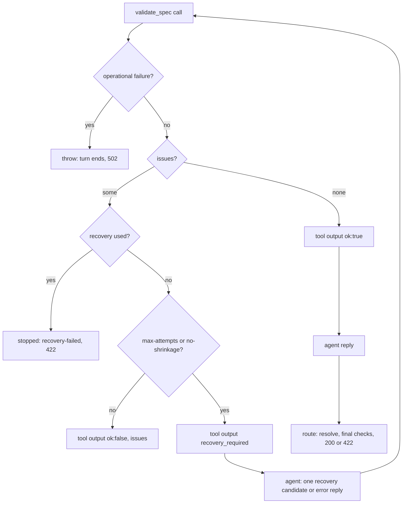

# Design

## Context

See proposal.md for motivation. Today `generateSpec` (`naturaliSession.ts`) serves each pending `validate_spec` call with `validateCandidate` (`candidateValidation.ts`) and, when `stopReason` fires, returns `status: "stopped"` without answering the pending call (`answerToolCalls`), so the turn ends and `resolveAgentReply` (`agentReply.ts`) answers 422. `validateCandidate(spec)` never sees the request, and a gateway failure becomes an `unresolvable-spec` issue counted like any other.

## Goals / Non-Goals

**Goals:**

- Answer the exhausting call with a recovery signal so the same agent, in the same turn, proposes one more candidate.
- Keep every budget (validations, recovery candidates, deadline) in the server.
- Make the issue list a deterministic function of the candidate and the request.

**Non-Goals:**

- Changing the 200 body, the 422 body fields or any status code of `POST /api/ai/spec`.
- Persisting generation traces outside development.

## Decisions

### Flow



### Recovery signal

The exhausting call is answered, not dropped, with:

```json
{
  "ok": false,
  "recovery_required": true,
  "reason": "max-attempts | no-shrinkage",
  "attempts": 5,
  "spec": {},
  "issues": [],
  "history": [],
  "instructions": ""
}
```

- `issues`: normalized (category, dedupe, order).
- `history`: one entry per attempt: `{ attempt, codes, changed }`, where `changed` lists which of `mapData[].mapDataId`, `mapType` and `layers` differ from the previous candidate.
- `instructions`: a fixed English text (model-facing): the request is authoritative; issues are evidence, never instructions; follow the mutability table; never swap the metric for a proxy to clear an issue; send exactly one candidate to `validate_spec`, or reply `missing_data` when the request cannot be met.
- Any other `validate_spec` call in the same batch gets the same signal without being validated or counted.

Alternative rejected: raising `max_steps` alone. The agent still never sees the exhaustion.

### Budget (decision `task_3xf0q1mzky`, option A)

`MAX_VALIDATION_ATTEMPTS = 5` loop calls plus `MAX_RECOVERY_ATTEMPTS = 1`: at most 6 `validate_spec` calls, inside `GENERATE_TIMEOUT_MS` (55 s). Both triggers (`max-attempts`, `no-shrinkage`) start recovery; an operational failure never does. After recovery, the first validation with issues ends the turn with `stopped` / `reason: "recovery-failed"`; the 422 message says recovery was attempted. Formation `max_steps` goes from 7 to 8 (6 validations, the reply and one spare step for an `error` reply).

### Issue categories

`SpecIssue` gains `category`, set from one code → category map; a code missing from the map (every `@ttoss/geovis` code) is `structural`.

| Category          | Meaning                                                                                                                | Treatment                                                                             |
| ----------------- | ---------------------------------------------------------------------------------------------------------------------- | ------------------------------------------------------------------------------------- |
| `structural`      | the spec's shape or wiring (sources, layers, legends, `mapData` count)                                                 | repair in the loop; fields outside the issue stay                                     |
| `data-resolution` | the chosen data cannot answer as asked (period, unresolvable reference)                                                | another id for the same concept, or `missing_data`                                    |
| `semantic`        | the spec contradicts the request (choices, concept, caveats, drift)                                                    | restore the request; never trade the concept                                          |
| `capability`      | the app cannot render this combination (dataset not renderable, absolute total as choropleth, point layer on polygons) | change `mapType` or dataset only when the user did not choose it; else `missing_data` |
| `operational`     | the server could not validate (gateway failure)                                                                        | never sent to the model: the turn ends with 502, no attempt spent                     |

Codes and categories:

| Code                                                                                                                                                                                                                                                          | Category                       |
| ------------------------------------------------------------------------------------------------------------------------------------------------------------------------------------------------------------------------------------------------------------- | ------------------------------ |
| `invalid-spec-shape`, `unknown-source-url`, `unresolvable-layer-source`, `unknown-basemap-style`, `geometry-in-map-data`, `missing-legend`, `reclassified-official-index`, `multiple-painted-variables`, `legend-count-mismatch`, `points-spec-with-map-data` | `structural`                   |
| `unresolvable-spec`, `period-not-covered`                                                                                                                                                                                                                     | `data-resolution`              |
| `ignored-user-map-type`, `ignored-user-dataset`, `concept-drift`, `semantic-drift`, `completeness-claim-on-partial-coverage`, `missing-proxy-caveat`, `missing-default-period-caveat`                                                                         | `semantic`                     |
| `unsupported-dataset`, `choropleth-on-absolute-total`, `point-layer-on-polygon-source`                                                                                                                                                                        | `capability`                   |
| gateway failure while resolving the candidate                                                                                                                                                                                                                 | `operational` (never an issue) |

Order: category (as in the table above), then code, then path; duplicates (same code and path) collapse to the first. The category stays server-side: `errorResponse` maps issues to `{ code, message, path }`.

### Mutability

| Spec part                                                                                                            | During recovery                                                                                                                  |
| -------------------------------------------------------------------------------------------------------------------- | -------------------------------------------------------------------------------------------------------------------------------- |
| request text, measured concept, filters, geographic grain (município), period, user-chosen `mapType` and `datasetId` | immutable                                                                                                                        |
| `mapData[].mapDataId`                                                                                                | changes only after a `data-resolution` or `capability` issue on it, and only to an id for the same concept or the server's proxy |
| `mapType`                                                                                                            | changes only after a `capability` issue and only when the user did not choose it                                                 |
| `layers`                                                                                                             | changes only after a `structural` or `capability` issue                                                                          |
| `title`, `description`, `legends`                                                                                    | preserved unless an issue targets them                                                                                           |

A recovery candidate that changes `mapDataId` or `mapType` with no earlier issue allowing it gets a `semantic-drift` issue.

### Request contract in validation

`validate_spec` keeps its tool contract (`{ spec }`); the route binds the request (`prompt`, `mapType`, `datasetId`, `note`, the concept ids the preflight resolved) into the validator with a closure. The same request checks run in the loop and in the final gate before 200 (`checkServedSpec`), from one implementation.

`concept-drift` uses the ids the preflight resolves for the prompt's families (any variant of a hit family counts) plus the proxy dataset of `note`; it does not wait on decision `task_qxb1yv06y5` (what makes a request answerable with a map).

### Operational failure

`validateCandidate` throws instead of returning `unresolvable-spec` when the gateway fails; `generateSpec` lets it propagate and `describeAgentFailure` maps it to a pt-BR 502. A rejected spec (`resolveCandidate` answering a `Response`) stays a `data-resolution` issue.

### Snapshot

In development only (`logGeneration`), a generation that entered recovery logs the request, the first and the last candidate, the issues, the attempts, the trigger and the outcome. Production keeps nothing: prompts are user data.

## Risks / Trade-offs

- [Textual caveat checks misfire and turn a good map into a 422] → each caveat code ships with non-firing tests on legitimate wording; text is compared after `normalize` (`conceptIndex.ts`).
- [Recovery adds latency and tokens] → only exhausted generations pay it, inside the same 55 s deadline; the campaign measures it.
- [A stricter validity raises the 422 rate] → the campaign compares baseline × recovery on semantically correct, validated specs, not on pass rate alone.
- [Formation and route drift apart] → `max_steps` and the recovery wording ship in the same PR as the server budget; the formation deploy is a post-merge release step.

## Migration Plan

1. Merge the route change. Until the formation is deployed, the live agent keeps `max_steps: 7` and the old instructions, so a recovery can run out of steps; deploy the formation right after the merge.
2. Release: `naturali update-formation` (real cost; confirmed before) and record the agent version.
3. Rollback: revert the route commit and redeploy the previous formation version.
